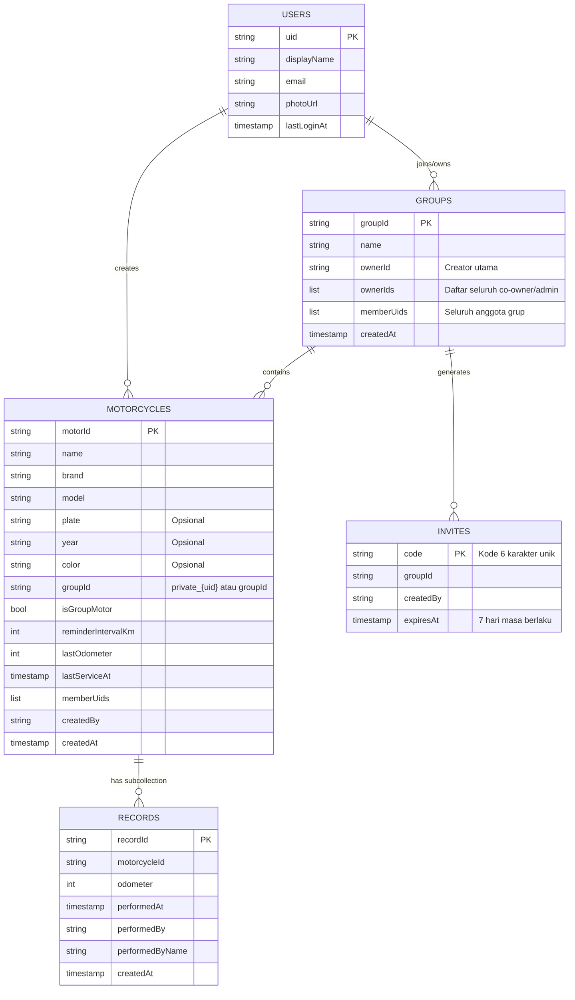

<div align="center">

  

  # 🏍️ MotorQu
  ### *Smart Motorcycle Oil Tracker & Family Fleet Management*

  **Aplikasi pencatatan dan monitoring servis oli motor keluarga yang simpel, cepat, dan otomatis.**  
  *Rawat motor bersama, bebas lupa ganti oli, dan pantau kondisi seluruh motor keluarga dalam satu genggaman.*

  <p align="center">
    <a href="https://github.com/ridlofw/motorqu/releases/latest">
      
    </a>
    <a href="https://flutter.dev">
      
    </a>
    <a href="https://dart.dev">
      
    </a>
    <a href="https://firebase.google.com/">
      
    </a>
    <a href="https://github.com/ridlofw/motorqu/actions/workflows/publish-update.yml">
      
    </a>
    <a href="LICENSE">
      
    </a>
  </p>

  <p align="center">
    <a href="#-tentang-motorqu">Tentang</a> •
    <a href="#-fitur-unggulan">Fitur Unggulan</a> •
    <a href="#-desain-antarmuka--alur-aplikasi">Desain & Alur</a> •
    <a href="#-arsitektur-dan-skema-data">Arsitektur & Skema</a> •
    <a href="#-teknologi-yang-digunakan">Teknologi</a> •
    <a href="#-instalasi--persiapan">Instalasi</a> •
    <a href="#-sistem-auto-update-ota">Auto-Update OTA</a> •
    <a href="#-ci-cd--otomasi-rilis">CI/CD</a> •
    <a href="#-panduan-penggunaan">Panduan</a>
  </p>

  ---
</div>

<br/>

## 📖 Tentang MotorQu

Sebagian besar pemilik sepeda motor di Indonesia sering kali **terlambat mengganti oli mesin** hanya karena:
1. **Lupa odometer terakhir** saat penggantian oli sebelumnya.
2. **Stiker kertas pengingat dari bengkel** cepat pudar, terkena air cuci motor, atau hilang.
3. **Motor digunakan bersama** oleh beberapa anggota keluarga (misal: motor dipakai adik, kakak, atau orang tua), sehingga tidak ada yang tahu pasti siapa yang terakhir merawat motor tersebut.
4. **Aplikasi logbook kendaraan umum terlalu rumit**: mewajibkan pengisian harga, bengkel, merk oli, nota foto, dan parameter lain yang memakan waktu lama sehingga pengguna malas mencatat.

**MotorQu hadir memberikan solusi tuntas dengan filosofi *Zero-Friction & Family-First*:**
- **Pencatatan 5 Detik**: Hanya membutuhkan input **Tanggal** dan **KM Odometer**. Tidak ada input berbelit-belit.
- **Kolaborasi Keluarga (Multi-Owner)**: Motor yang dibagikan ke grup keluarga bisa dipantau dan dicatat olinya oleh seluruh anggota keluarga secara *real-time*.
- **Pengingat Cerdas Ganda**: Menghitung jatuh tempo tidak hanya dari jarak tempuh (+KM), tetapi juga batas waktu aman (30 hari sejak servis terakhir).

---

## ✨ Fitur Unggulan

### 1. ⚡ Input Kilat (Super Minimalist Logging)
Catat penggantian oli tanpa distraksi. Cukup pilih motor, tentukan tanggal, lalu masukkan angka KM di odometer motor saat ini. Data tersimpan dalam hitungan detik.

### 2. 👨‍👩‍👧‍👦 Grup Keluarga & Manajemen Multi-Owner (Ala Admin WhatsApp)
- **Banyak Grup Sekaligus (Multi-Group)**: Buat grup untuk keluarga inti, motor kantor, maupun komunitas motor.
- **Sistem Co-Owner / Co-Admin**: Grup dapat memiliki lebih dari satu owner. Co-owner memiliki wewenang untuk:
  - Mengangkat anggota biasa menjadi owner (*promote*).
  - Menurunkan status sesama owner (*demote*).
  - Mengeluarkan anggota dari grup (*kick*).
  - Mengeluarkan motor anggota lain dari grup jika sudah tidak relevan.
- **Kode Undangan 6-Karakter (Single-Use)**: Gabung ke grup semudah memasukkan kode 6 digit (contoh: `MTR789`). Kode otomatis kadaluarsa dalam 7 hari dan hangus seketika setelah digunakan untuk mencegah akses tidak sah.
- **Proteksi Kepemilikan Motor**: Saat motor dikeluarkan dari grup atau saat anggota keluar/dikeluarkan, motor tersebut **tidak akan terhapus**, melainkan otomatis ditarik kembali menjadi motor pribadi pemilik aslinya.

### 3. 🎯 Deteksi Jatuh Tempo Ganda (*Dual-Trigger Overdue*)
Status servis dihitung secara matematis menggunakan dua parameter:
- **Jarak Tempuh**: Target servis berikutnya = $\text{KM Terakhir} + \text{Interval Servis}$ (default 2.000 KM, dapat diubah sesuai rekomendasi pabrikan).
- **Usia Oli (30 Hari)**: Mengingat oli mesin mengalami degradasi kimiawi meskipun motor jarang digunakan, sistem otomatis menandai motor sebagai **"Perlu Dicek"** jika sudah $\ge 30\text{ hari}$ sejak penggantian oli terakhir.

### 4. 📜 Timeline Riwayat Interaktif & Selisih KM Otomatis
- Tampilan riwayat ganti oli berbentuk garis waktu vertikal (*stepper timeline*).
- Otomatis menghitung selisih jarak pemakaian antar pencatatan:
  $$\Delta \text{KM} = \text{KM}_{\text{sekarang}} - \text{KM}_{\text{sebelumnya}}$$
- Dilengkapi nama pencatat untuk transparansi antar anggota keluarga.
- Fitur hapus riwayat duplikat yang otomatis memperbarui status KM motor ke catatan sebelumnya.

### 5. 🔔 Pengingat Lokal Otomatis (*Smart Notifications*)
- Berjalan di latar belakang menggunakan `flutter_local_notifications` terintegrasi zona waktu lokal (`Asia/Jakarta`).
- **Auto-Sync saat Buka Aplikasi**: Menjadwalkan pengingat secara otomatis untuk semua motor (baik motor pribadi maupun motor dari seluruh grup yang diikuti).
- **Deep-Linking**: Mengetuk notifikasi langsung membuka formulir *Catat Ganti Oli* dengan motor yang bersangkutan sudah otomatis terpilih.
- **Master Switch**: Pengguna dapat mematikan seluruh notifikasi sekaligus di tab Profil tanpa harus mengedit pengaturan motor satu per satu, serta tersedia tombol pengujian notifikasi (*Test Notification*).

### 6. 🔄 Pembaruan Aplikasi Otomatis (In-App Resumable OTA Updater)
- Tidak perlu repot mengunduh ulang APK dari browser saat ada pembaruan rilis.
- Aplikasi mendeteksi versi terbaru melalui GitHub Releases API (dengan fallback ke Firebase Hosting).
- **Fitur Unduh Resume (HTTP 206)**: Jika koneksi internet terputus di tengah jalan, unduhan akan dilanjutkan dari byte terakhir yang tersimpan, bukan mengulang dari 0%. Dilengkapi auto-retry hingga 8 kali.
- **Pemasangan Mandiri Aman**: Menggunakan Android `FileProvider` (`open_filex`), tanpa memerlukan izin sistem berbahaya seperti `MANAGE_EXTERNAL_STORAGE`.

### 7. 🔐 Autentikasi Google Satu Ketukan (*One-Tap Google Sign-In*)
Masuk secara instan menggunakan akun Google yang sudah tertaut di perangkat Android tanpa perlu mengingat username dan kata sandi baru.

---

## 📱 Desain Antarmuka & Alur Aplikasi

MotorQu mengadopsi prinsip desain **Material Design 3** dengan palet warna bersih, sudut membulat elegan (*rounded 16–24px*), elevasi halus, serta hierarki visual yang kontras.

```
┌─────────────────────────────────────────────────────────────┐
│                         NAVIGASI UTAMA                      │
├──────────────────────────────┬──────────────┬───────────────┤
│           🏍️ MOTOR           │      ➕      │   👤 PROFIL   │
│ (Dashboard & Ringkasan Oli)  │ (Aksi Cepat) │ (Grup & Akun) │
└──────────────────────────────┴──────────────┴───────────────┘
```

### Visual Navigasi & Alur Layar

```
                        ┌──────────────────┐
                        │   Login Screen   │
                        │ (Google Sign-In) │
                        └────────┬─────────┘
                                 │
                                 ▼
                     ┌───────────────────────┐
       ┌─────────────┤      Home Screen      ├─────────────┐
       │             └───────────────────────┘             │
       ▼                         ▼                         ▼
┌──────────────┐         ┌───────────────┐         ┌──────────────┐
│  Tab Motor   │         │ Action Sheet  │         │  Tab Profil  │
│ (Dashboard & │         │   Tombol ➕   │         │ (Multi-Grup, │
│  Card List)  │         └───────┬───────┘         │  Notifikasi, │
└──────┬───────┘                 │                 │ OTA Update)  │
       │                         ▼                 └──────┬───────┘
       │           ┌───────────────────────────┐          │
       │           │ • 🛢️  Catat Ganti Oli     │          ▼
       │           │ • 🏍️  Tambah Motor        │   ┌──────────────┐
       │           │ • 👥  Buat Grup Baru      │   │ Layar Kelola │
       │           │ • 🔑  Gabung Grup (Kode)  │   │     Grup     │
       │           └───────────────────────────┘   └──────────────┘
       ▼
┌──────────────┐
│ Detail Motor │
│ (Timeline &  │
│ Δ KM Tracker)│
└──────────────┘
```

### Struktur Antarmuka

| Layar | Elemen Kunci | Keterangan |
|---|---|---|
| **Beranda (Home)** | Kartu Ringkasan Metrik (Total Motor, Aman, Perlu Dicek), Filter Tab (Semua, Pribadi, Grup), Daftar Kartu Motor dengan Badge Status. | Memberikan gambaran kondisi seluruh motor dalam 1 detik. |
| **Aksi Cepat (`+`)** | Bottom Sheet mengapung dengan 4 aksi: Catat Oli, Tambah Motor, Buat Grup, Masuk Grup. | Akses satu sentuhan ke seluruh fungsi utama aplikasi. |
| **Detail Motor** | Badge Kepemilikan, Tombol Update Cepat, *Vertical Timeline* riwayat oli lengkap dengan perhitungan $\Delta$ KM, Informasi Spesifikasi Motor, dan Tombol Hapus. | Pusat data riwayat pemeliharaan motor secara mendalam. |
| **Catat Ganti Oli** | Dropdown Motor, Kalender Tanggal (Date Picker), Odometer KM saat ganti. | Formulir super ringkas tanpa isian yang membuang waktu. |
| **Kelola Grup** | Nama grup (dapat diubah owner), Kode Undangan 6 karakter + tombol salin/bagikan ke WhatsApp, Daftar Anggota (Promote/Demote/Kick), Daftar Motor Grup. | Tata kelola anggota keluarga dan motor bersama dengan hak akses terproteksi. |
| **Profil Pengguna** | Info akun Google, Daftar grup yang diikuti, Tombol Buat/Gabung Grup, Saklar Notifikasi, Tombol Cek Pembaruan Versi, Tombol Logout. | Pengaturan umum dan manajemen ekosistem aplikasi. |

---

## 🏗️ Arsitektur dan Skema Data

MotorQu dibangun dengan arsitektur modular berlapis (*Service-Repository Pattern*) yang memisahkan logika UI, state, dan interaksi Firestore.

```
lib/
├── main.dart                      # Inisialisasi Firebase, notifikasi deep-linking, router
├── firebase_options.dart          # Konfigurasi platform Firebase
├── models/                        # Entitas Data
│   ├── motorcycle.dart            # Model data motor & kalkulasi target KM
│   ├── oil_record.dart            # Model riwayat penggantian oli
│   └── group.dart                 # Model grup keluarga & logika multi-owner
├── services/                      # Logika Bisnis & Backend
│   ├── auth_service.dart          # Otentikasi Google Sign-In & sinkronisasi user
│   ├── database_service.dart      # Firestore queries, real-time streams, perizinan grup
│   ├── notification_service.dart  # Penjadwalan notifikasi berkala & handler tap
│   └── update_service.dart        # Engine updater HTTP 206 resumable & installer APK
└── ui/                            # Presentasi & Antarmuka Pengguna
    ├── login_screen.dart          # Layar login Google
    ├── home_screen.dart           # Layar utama, dashboard metrik, dan action sheet
    ├── motor_detail_screen.dart   # Detail motor & timeline delta KM
    ├── add_motor_screen.dart      # Formulir tambah/edit motor (pribadi vs grup)
    ├── add_oil_screen.dart        # Formulir pencatatan oli kilat
    ├── group_screen.dart          # Layar manajemen grup, anggota, dan kode undangan
    └── profile_screen.dart        # Layar profil, preferensi, dan in-app updater
```

### Skema Cloud Firestore



---

## 🛠️ Teknologi yang Digunakan

| Kategori | Teknologi | Deskripsi |
|---|---|---|
| **Core Framework** | [Flutter](https://flutter.dev) (v3.13+) | Framework UI multiplatform modern berbasis Dart. |
| **Language** | [Dart](https://dart.dev) | Bahasa pemrograman bertipe aman (*sound null-safety*). |
| **Backend & Cloud** | [Google Firebase](https://firebase.google.com) | Backend tanpa server: Auth, Cloud Firestore, Firebase Hosting. |
| **Authentication** | `firebase_auth`, `google_sign_in` | Otentikasi Google Sign-In instan dan aman. |
| **Database** | `cloud_firestore` | Sinkronisasi database NoSQL *real-time* multi-perangkat. |
| **Notifications** | `flutter_local_notifications`, `timezone` | Penjadwalan notifikasi lokal berbasis interval waktu dan zona waktu lokal. |
| **Networking & OTA** | `http`, `open_filex`, `path_provider` | Download manager dengan HTTP Range 206 dan eksekusi instalasi paket APK. |
| **State & Storage** | `shared_preferences`, `intl` | Penyimpanan preferensi lokal dan formatting tanggal bahasa Indonesia. |
| **DevOps & CI/CD** | GitHub Actions, Gradle Kotlin DSL | Pipeline rilis otomatis APK rilis bertanda tangan keystore. |

---

## 🚀 Instalasi & Persiapan

### Prasyarat Pengembangan
Pastikan perangkat pengembang Anda telah terpasang:
1. **Flutter SDK** (versi `^3.13.5` atau yang lebih baru) → `flutter doctor`
2. **Java Development Kit (JDK 17)**
3. **Android Studio** atau **VS Code** beserta ekstensi Flutter/Dart
4. Perangkat Android fisik atau Emulator Android (API Level 21+)

### Langkah Instalasi

1. **Clone Repositori:**
   ```bash
   git clone https://github.com/ridlofw/motorqu.git
   cd motorqu
   ```

2. **Pasang Dependensi Flutter:**
   ```bash
   flutter pub get
   ```

3. **Konfigurasi Firebase:**
   - Masukkan file `google-services.json` yang diperoleh dari Firebase Console ke dalam folder `android/app/`.
   - Pastikan Firebase Authentication (Google Provider) dan Cloud Firestore telah diaktifkan di konsol Firebase proyek Anda.

4. **Konfigurasi Signing Key (Opsional untuk Rilis Lokal):**
   - Siapkan file `android/key.properties` dan `android/keystore/motorqu.jks` jika ingin melakukan *release build* lokal.

5. **Jalankan Aplikasi:**
   ```bash
   flutter run
   ```

6. **Build APK Rilis:**
   ```bash
   flutter build apk --release
   ```
   File APK hasil kompilasi akan berada di: `build/app/outputs/flutter-apk/app-release.apk`.

---

## 🔄 Sistem Auto-Update (OTA Updater)

MotorQu mengimplementasikan modul pembaruan in-app mandiri tanpa melalui Play Store:

```
[ Buka Profil / Cek Update ]
             │
             ▼
[ Request ke latest.json ]
  ├── 1. GitHub Releases API (Prioritas Utama)
  └── 2. Firebase Hosting appMeta (Fallback)
             │
             ▼
[ Bandingkan versionCode ]
  ├── versionCode server > local buildNumber  --> Tampilkan Dialog Update
  └── versionCode server <= local buildNumber --> Tampilkan "Versi Terkini"
             │
             ▼
[ Pengguna Menekan "Unduh & Install" ]
             │
             ▼
[ Unduh APK dengan HTTP Range 206 (Resumable) ]
  ├── Koneksi Putus? --> Retry otomatis hingga 8x, lanjutkan byte tersimpan
  └── Selesai --> Buka Android Package Installer via OpenFilex
```

### Format Metadata `latest.json`
```json
{
  "versionName": "1.0.9",
  "versionCode": "10",
  "apkUrl": "https://github.com/ridlofw/motorqu/releases/latest/download/app-release.apk",
  "notes": "Pembaruan v1.0.9: Perbaikan menyeluruh 7 bug hasil audit mendalam.",
  "updatedAt": "2026-10-28T08:00:00Z"
}
```

---

## ⚙️ CI/CD & Otomasi Rilis

Aplikasi ini dilengkapi alur kerja otomatisasi rilis berbasis **GitHub Actions** (`.github/workflows/publish-update.yml`):

1. **Trigering**: Setiap kali terjadi `push` ke branch `main` (kecuali file dokumentasi seperti `README.md` dan `.gitignore`), alur kerja otomatis berjalan.
2. **Ekstraksi Versi**: Membaca otomatis `versionName` dan `versionCode` langsung dari `pubspec.yaml`.
3. **Build APK Bertanda Tangan**: Mengompilasi `flutter build apk --release` menggunakan JDK 17 dan Flutter stable channel.
4. **Publish GitHub Release**:
   - Otomatis membuat tag rilis baru (contoh: `v1.0.9-10`).
   - Mengunggah file biner `app-release.apk` dan file manifes `latest.json`.
   - Mengatur rilis sebagai *Latest Release*.
5. **Mirror ke Firebase Hosting**: Mengunggah file metadata cadangan ke Firebase Hosting channel live.

---

## 📋 Panduan Penggunaan Singkat

### A. Menambahkan Motor Baru
1. Tekan tombol bulat **`+`** di bagian tengah navigasi bawah.
2. Pilih menu **"Tambah Motor Baru"**.
3. Isi nama motor (misal: *Vario 160*), merk, tipe, dan KM awal saat ini.
4. Tentukan opsi simpan:
   - **Motor Saya Pribadi**: Hanya tampil di HP Anda.
   - **Bagikan ke Grup Keluarga**: Otomatis muncul di HP seluruh anggota grup.
5. Tekan **"Daftarkan Motor"**.

### B. Mencatat Ganti Oli
1. Tekan tombol **`+`** lalu pilih **"Catat Ganti Oli"** (atau tekan tombol **"Update Ganti Oli"** langsung dari halaman Detail Motor).
2. Pilih motor dari dropdown.
3. Masukkan angka KM odometer saat penggantian oli dilakukan.
4. Tekan **"Simpan Catatan"**. Pengingat servis otomatis terjadwal untuk interval berikutnya!

### C. Mengelola Grup Keluarga
1. Buka tab **Profil** lalu pilih kartu grup Anda (atau tekan tombol `+` > **"Buat Grup"**).
2. Tekan **"Buat Kode Undangan"** untuk menghasilkan kode 6 digit yang dapat dibagikan langsung ke WhatsApp anggota keluarga.
3. Untuk mengangkat co-admin/owner baru, buka menu anggota di layar Kelola Grup, lalu pilih **"Jadikan Owner"**.

---

## 🔒 Aturan Keamanan Firestore (*Security Rules*)

Keamanan data pada MotorQu dijamin melalui Cloud Firestore Security Rules:
- **Pengguna**: Hanya pengguna yang telah melakukan autentikasi (`request.auth != null`) yang dapat membaca data. Pengguna hanya dapat memperbarui profil miliknya sendiri.
- **Motor & Riwayat**: Dilindungi oleh aturan validasi autentikasi aktif dan keanggotaan grup terkait.
- **Kode Undangan**: Kode undangan dapat dibaca publik untuk verifikasi pendaftaran awal, namun pembuatan dan penghapusan kode hanya diizinkan untuk pengguna yang terautentikasi.
- **Metadata Update**: Dokumen `appMeta` bersifat hanya-baca (*read-only*) untuk publik dan tidak dapat diubah oleh klien.

---

## 🗺️ Roadmap Pengembangan

- [x] Autentikasi Google Sign-In & Sinkronisasi Profil User
- [x] Dashboard Ringkasan & Filter Multi-Motor
- [x] Pencatatan Ganti Oli Minimalis (KM & Tanggal)
- [x] Visualisasi Timeline Riwayat & Kalkulasi $\Delta$ KM
- [x] Sistem Multi-Grup & Multi-Owner (Admin WhatsApp style)
- [x] Pengingat Lokal Otomatis & Deep Link Notifikasi
- [x] In-App Resumable OTA APK Updater (HTTP 206)
- [x] CI/CD Pipeline GitHub Actions
- [ ] Dukungan Catatan Biaya & Bengkel (Opsi Lanjutan / Toggle Opsional)
- [ ] Export Laporan Riwayat Servis ke Format PDF / CSV
- [ ] Estimasi Penggantian Komponen Lain (Filter Udara, Busi, Kampas Rem, V-Belt)
- [ ] Sinkronisasi Firebase Cloud Messaging (FCM) Push Notifications

---

## 🤝 Kontribusi

Kontribusi selalu terbuka dan diapresiasi! Jika Anda menemukan bug atau memiliki ide perbaikan fitur:
1. *Fork* repositori ini.
2. Buat branch fitur baru (`git checkout -b fitur/fitur-keren-anda`).
3. Lakukan commit perubahan Anda (`git commit -m 'Menambahkan fitur keren'`).
4. *Push* ke branch Anda (`git push origin fitur/fitur-keren-anda`).
5. Buat **Pull Request**.

---

## 📄 Lisensi

Proyek ini dirilis di bawah lisensi [MIT License](LICENSE). Anda bebas menggunakan, memodifikasi, dan mendistribusikan kode ini untuk tujuan personal maupun komersial.

---

<div align="center">
  <sub>Dibuat dengan ❤️ oleh <a href="https://github.com/ridlofw">Ridlo FW</a> untuk mempermudah perawatan motor keluarga di seluruh Indonesia.</sub>
</div>
